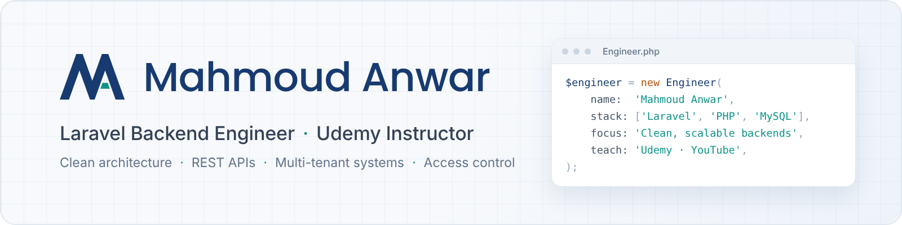

<picture>
  <source media="(prefers-color-scheme: dark)" srcset="./assets/banner-dark.png">
  
</picture>

  <a href="https://mahmoudanwar.com/"><b>Website</b></a> &nbsp;·&nbsp;
  <a href="https://www.linkedin.com/in/mahmoud-anwer/"><b>LinkedIn</b></a> &nbsp;·&nbsp;
  <a href="https://www.udemy.com/user/engsahaly/"><b>Udemy</b></a> &nbsp;·&nbsp;
  <a href="https://www.youtube.com/@MahmoudAnwarDev"><b>YouTube</b></a> &nbsp;·&nbsp;
  <a href="https://mahmoudanwar.com/contact"><b>Contact</b></a>

 

I'm a **backend engineer** who builds Laravel applications that stay clean as they grow: multi-tenant systems, REST APIs, and role-based access control with clear boundaries and testable code.

I also **teach**. My Udemy courses and YouTube channel turn real project experience into practical, step-by-step lessons for Laravel developers.

 

### What I work on

- **Backend architecture**: Laravel, SOLID, design patterns, structured and testable code
- **APIs**: RESTful design, authentication, clear contracts between frontend and backend
- **Access control**: multi-authentication, policies, gates and role-based permissions
- **Multi-tenant systems**: one codebase serving many organizations safely
- **Teaching**: courses and videos that explain the *why*, not just the *how*

 

### Selected work

Most of my client work is private, so the full case studies live on my website:

**Medad Library Portal** · 
**Makanat Platform** · 
**Osool Daema Contracting App** · 
**CCIT Software Solutions Platform** · 
**Furniture Agencies Management System** · 
**Wejha App**
**Acadets Learning Platform**

→ [Read the case studies](https://mahmoudanwar.com/projects)

 

### Courses & course code

| Course | Source code |
|---|---|

| [Laravel Caching Masterclass: Cache, Redis & Performance](https://www.udemy.com/course/laravel-caching-redis-performance/?referralCode=807ECA49D844054B202D) | [Project Files](https://github.com/engsahaly/laravel-caching-course) |

| [Laravel Queues in Practice: Jobs, Batching & Workers](https://www.udemy.com/course/laravel-queues/?referralCode=5D9E51A6CD64E75EC6F8) | [Project Files](https://github.com/engsahaly/laravel_queues_jobs_course) |

| [Filament PHP Mastery: Build Modern Admin Panels Quickly](https://www.udemy.com/course/filament-php-mastery/?referralCode=F8370783A5740F7A039D) | [Project Files](https://github.com/engsahaly/filament_php_course) |

| [Laravel Testing Series Part 2: Mastering Pest PHP](https://www.udemy.com/course/mastering-pest-php/?referralCode=7A96B8871AFE99D9D519) | [Project Files](https://github.com/engsahaly/Laravel_testing_series_pest_php) |

| [Laravel Scout Search with Algolia, Meilisearch & Typesense](https://www.udemy.com/course/laravel-scout-search-with-algolia-meilisearch-typesense/?referralCode=68C7CD77FCCE6EE457D7) | [Project Files](https://github.com/engsahaly/laravel-scout-course) |

| [Mastering CI/CD with GitHub Actions: Automate, Test, Deploy](https://www.udemy.com/course/mastering-cicd-with-github-actions-automate-test-deploy/?referralCode=A75014190DAFC85F533B) | [Project Files](https://github.com/engsahaly/github-actions-course) |

| [Laravel Testing Series: PHPUnit & Xdebug Essentials](https://www.udemy.com/course/laravel-testing-phpunit/?referralCode=247893C01B1C98A4750C) | [Project Files](https://github.com/engsahaly/Laravel_testing_series_phpunit) |

| [Laravel Payments: A Complete Guide to Stripe and Cashier](https://www.udemy.com/course/laravel-payments-stripe-and-cashier/?referralCode=D51DB7FF2F303FEAC368) | [Project Files](https://github.com/engsahaly/stripe_cashier_subscriptions) . [Project Files](https://github.com/engsahaly/stripe_cashier_single_charge)|

| [Mastering Laravel Multi-Tenancy: Single & Multi-Databases](https://www.udemy.com/course/laravel-multi-tenancy/?referralCode=3061E518F49BF9D32B65) | [Project Files](https://github.com/engsahaly/mtenancy_custom_single) . [Project Files](https://github.com/engsahaly/mtenancy_custom_multi_db) . [Project Files](https://github.com/engsahaly/mtenancy_tenancy_for_laravel_single) . [Project Files](https://github.com/engsahaly/mtenancy_tenancy_for_laravel_multi)|

| [Mastering Laravel Eloquent ORM: Novice to Expert Guide](https://www.udemy.com/course/laravel-eloquent-orm/?referralCode=848EFA56B9DA5F322B6D) | [Project Files](https://github.com/engsahaly/laravel_eloquent_ORM_course) |

| [Laravel 11 Updates - The Complete Guide](https://www.udemy.com/course/laravel-11-updates/?referralCode=CD4DF545CA3F6DA3D7B1) | [Project Files](https://github.com/engsahaly/laravel_11_updates_course) |

| [Laravel For Absolute Beginners 2024 - Level 2](https://www.udemy.com/course/laravel-for-absolute-beginners-level2/?referralCode=60292C152E890FBF45E0) | [Project Files](https://github.com/engsahaly/laravel_course_level_2) . [Project Files](https://github.com/engsahaly/laravel_course_level_2_project) |

| [Laravel For Absolute Beginners 2024](https://www.udemy.com/course/laravel-for-absolute-beginners/?referralCode=E4D9FDD77E498F158BC9) | [Project Files](https://github.com/engsahaly/laravel_course_level_1) .[Project Files](https://github.com/engsahaly/laravel_course_level_1_project) |

| [Laravel Real-time Guide: Pusher, Websockets, Echo and More!](https://www.udemy.com/course/laravel-real-time-guide-pusher-websockets-echo-and-more/?referralCode=8FE70694ED15CD82909C) | [Project Files](https://github.com/engsahaly/realtime_course) |

| [Laravel Verification Techniques: OTP, Email, CVT and More!](https://www.udemy.com/course/laravel-verification-techniques/?referralCode=53944E78010205CC1AC0) | [Project Files](https://github.com/engsahaly/laravel_verification_course) |

| [The Complete Livewire Course 2024: From Zero to hero!](https://www.udemy.com/course/the-complete-livewire-course-from-zero-to-hero/?referralCode=9A29FA0B8B4F1A538640) | [Project Files](https://github.com/engsahaly/livewire-project-course) . [Project Files](https://github.com/engsahaly/livewire_course) |

| [Laravel Telescope for Absolute Beginners](https://www.udemy.com/course/laravel-telescope-for-absolute-beginners-arabic/?referralCode=252E2C71C19417B2CD13) | [Project Files](https://github.com/engsahaly/laravel_telescope_course) |

| [Laravel Socialite - The Complete Guide](https://www.udemy.com/course/laravel-socialite-the-complete-guide-arabic/?referralCode=1CFCFF22E45A3114A239) | [Project Files](https://github.com/engsahaly/laravel_socialite_course) |

| [Laravel Jetstream & Fortify - The Complete Guide](https://www.udemy.com/course/laravel-jetstream-fortify-the-complete-guide-arabic/?referralCode=37FEC596B0C33451B73C) | [Project Files](https://github.com/engsahaly/laravel_jetstream_course) |

| [Laravel Multi Authentication & Authorization in Depth](https://www.udemy.com/course/laravel-multi-authentication-and-authorization-in-depth/?referralCode=04254DC0B4DC835F39A4) | [Project Files](https://github.com/engsahaly/Authentiation_and_authorization_course) |

| [Laravel RESTful APIs for beginners -Become a Master](https://www.udemy.com/course/laravel-restful-apis-for-beginners-become-a-master-arabic/?referralCode=E3B58D43D6A22007A562) | [Project Files](https://github.com/engsahaly/API-COURSE) |

 

### Latest articles

- [Browse all articles on mahmoudanwar.com](https://mahmoudanwar.com/insights)

 

### Tech stack

- **Backend:** PHP · Laravel · Livewire · MySQL · REST APIs . Drupal . Filament . Testing (PHPUnit, Pest PHP)
- **Frontend:** Blade · JavaScript · JQuery . AJAX · Bootstrap · HTML · CSS
- **Practices:** OOP · SOLID · Design patterns · Policy-based authorization
- **Tools:** Git · Docker . GitHub Actions (CI/CD)

 

### Let's work together

Need a custom web application, an API, or help structuring a Laravel codebase?
**[Start a conversation →](https://mahmoudanwar.com/contact?inquiry=custom-product#inquiry-form)**